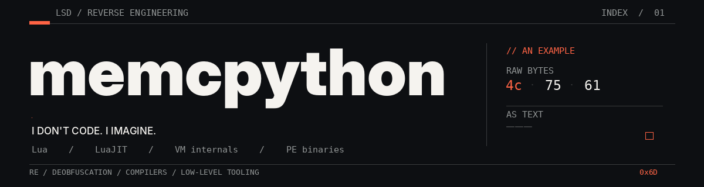

  

 

I spend most of my time pulling apart things that were designed to be difficult to read: obfuscated Lua, bytecode interpreters, virtual machines, and Windows binaries. Sometimes I build the protection instead.

No mystery tech stack. Mostly **Lua / Luau / LuaJIT**, **C / C++**, **C#**, **JavaScript / TypeScript**, and a lot of debugging.

### Work worth opening

| Repository | What it is |
| :-- | :-- |
| **[lua-deobfuscators](https://github.com/memcpython/lua-deobfuscators)** | A collection of Lua deobfuscation projects and experiments. |
| **[ironveil](https://github.com/memcpython/ironveil)** | AST-based Lua obfuscation with control-flow and constant transformations. |
| **[PE-Import-Obfuscator](https://github.com/memcpython/PE-Import-Obfuscator)** | PE import-table obfuscation in C++. |
| **[LuaTestCorpus](https://github.com/memcpython/LuaTestCorpus)** | A test corpus for Lua tooling. |
| **[no-slop](https://github.com/memcpython/no-slop)** | An agent skill against careless code generation and fake verification. |
| **[deobf](https://github.com/memcpython/deobf)** | An agent skill for evidence-driven deobfuscation and VM analysis. |

### Things I keep coming back to

`bytecode formats` · `VM dispatchers` · `devirtualization` · `compiler internals` · `control-flow recovery` · `PE internals`

Some longer-running experiments

- **LuaJIT decompilation** — reconstructing readable programs from bytecode.
- **Luraph 14.x analysis** — studying a virtualized Lua protection pipeline.
- **Lua obfuscation** — testing transformations across different Lua runtimes.

I don't treat partially recovered programs as finished. The interesting part is proving the recovery is correct.

---

Read the code, break the assumptions, keep the parts that actually work.
